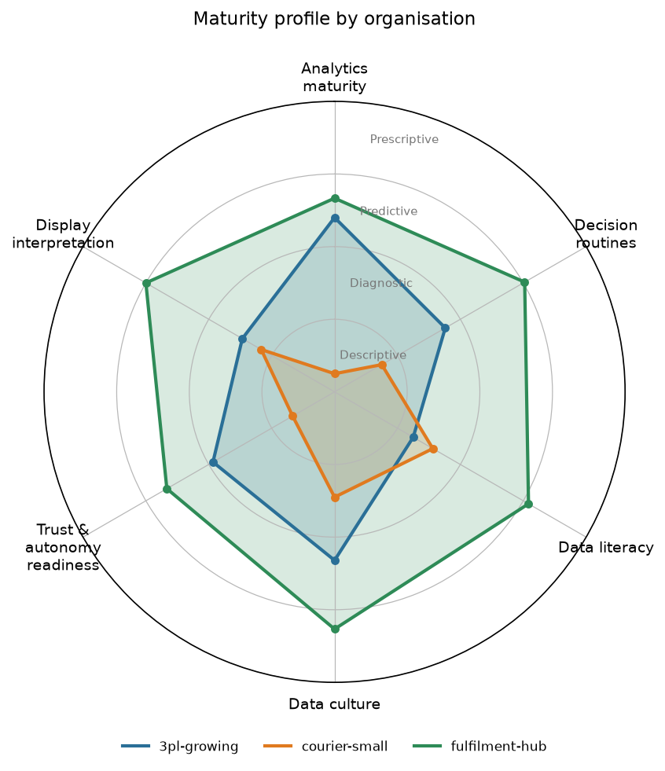
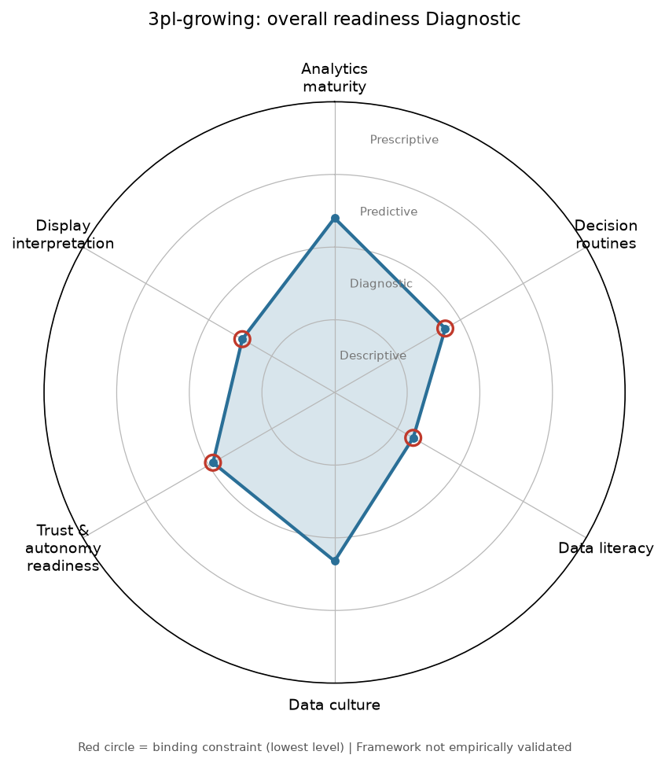

# Logistics Analytics Maturity Framework (LAMF)

> **Before a logistics SME buys predictive or autonomous technology, can its people, routines and culture actually use the data it will produce?**

AGVs, drones and "AI-powered" warehouse systems produce live, predictive and prescriptive data. Most small and mid-sized logistics firms are used to daily reports. My master's thesis found a gap that is easy to miss: when respondents moved from a familiar daily report to a live fleet dashboard, **comprehension fell sharply while the effort they reported barely changed**. People understood less without noticing. A firm can buy prescriptive technology and still run descriptively.

This tool turns that thesis's framework into a short self-assessment. It:
- scores six dimensions from a questionnaire (CSV);
- maps each one to a maturity level;
- names the **binding constraint**, the weakest layer that caps overall readiness;
- draws a radar chart and recommends next steps for each level.

> **Status: reviewed by me as the thesis author, not empirically validated.** The dimensions and questions come from my thesis instrument. The answer scoring, level thresholds and some next steps are design choices I added when building this tool; they have not been calibrated on real data, because the thesis was an exploratory pilot (n = 20) with no confirmatory test. All example data in this repository is **synthetic**: no thesis survey responses are used or included.

---

## The framework

The thesis models readiness for autonomous operational data as **firm maturity × individual literacy × display design, inside organisational culture**. The tool scores those layers as six dimensions on a 1–5 scale and maps each to the thesis's four analytics output stages:

| Level | Score | Meaning |
|---|---|---|
| **Descriptive** | 1.0 – 1.99 | Data records what happened |
| **Diagnostic** | 2.0 – 2.99 | Data explains why it happened |
| **Predictive** | 3.0 – 3.99 | Data anticipates what will happen |
| **Prescriptive** | 4.0 – 5.0 | Data and systems recommend or take the action |

| Dimension | What it measures | Theory (from the thesis) | Questions |
|---|---|---|---|
| Analytics maturity | What the firm's routines do with data | Davenport & Harris (2007); descriptive-to-prescriptive stages | Data-use stage |
| Decision routines | Whether data reliably drives responses | Dynamic capabilities (Teece) | Response style, practices in place, how disagreements are settled |
| Data literacy | Whether decision-makers can read the forms the new data takes | Sloan (2023); Sajoodi et al. (2025) | Trends, forecast ranges, colour maps, contradicting figures |
| Data culture | Whether the organisation encourages data-based action | Eisenhardt & Martin (2000) | Experimentation, checking data, blame vs learning, sharing, hierarchy (reversed) |
| Trust & autonomy readiness | Willingness to act on automated recommendations | Lee & See (2004) | Act on, rely on, let resolve exceptions |
| Display interpretation | Self-rated comprehension of complex live dashboards | Wickens et al. (2015); Stanton et al. (2013) | Comprehension, confidence, mental effort (reversed) |

Accountability and explainability questions aren't scored; they drive **diagnostic flags**.

### Why the overall level is the weakest link

The overall readiness is the **lowest** dimension level, not the average. The thesis argues that "maturity models alone are a poor guide to readiness": a firm at the predictive stage whose managers can't read a forecast range will hesitate, call for human confirmation, and get little back from its investment. The report names the dimensions at that lowest level and says **where to start** (the lowest-scoring of them).

### Diagnostic flags (from thesis findings)

| Flag | Fires when | Meaning |
|---|---|---|
| Firm ahead of its people | Maturity level is above literacy level | Analytics depends on one or two key people |
| Explainability required | Respondents want to see the system's reasoning | Make "what fired it, what was weighed, how confident" a procurement requirement |
| Accountability exposure | Respondents expect personal and legal exposure | Set a human-in-the-loop policy before increasing autonomy |
| Weak at conflicting data | The "which figure to trust" item lags the other literacy items | The exact skill an autonomous fleet display demands |
| Self-reported comprehension | Always, when display interpretation is scored | Self-report can overstate understanding; verify with an observed task |

## Sample output (synthetic data)

Three fictional organisations, generated by `lamf synth`:

| Organisation (fictional) | Profile | Overall | Start with |
|---|---|---|---|
| courier-small | Owner-run courier using spreadsheets and phone calls | **Descriptive** | Analytics maturity |
| 3pl-growing | Bought a predictive WMS add-on; analytics sits with one person | **Diagnostic** | Data literacy |
| fulfilment-hub | Data-led hub piloting AGVs | **Predictive** | Analytics maturity |



**One organisation in detail: 3pl-growing (synthetic)**



| Dimension | Score | Level |
|---|---:|---|
| Analytics maturity | 3.40 | Predictive |
| Decision routines | 2.76 | Diagnostic (binding) |
| Data literacy | 2.25 | Diagnostic (binding, **start here**) |
| Data culture | 3.32 | Predictive |
| Trust & autonomy readiness | 2.93 | Diagnostic (binding) |
| Display interpretation | 2.47 | Diagnostic (binding) |

This firm bought predictive tooling (maturity: Predictive), but its decision-makers' literacy is Diagnostic, so the **"firm ahead of its people"** flag fires. The weakest literacy item is "which of two contradicting figures to trust". The report's first recommendations are:
- Train specifically on forecast ranges and uncertainty, not only on single figures. *(from thesis)*
- Practise reconciling contradictory figures: which source, which timestamp, which definition. *(from thesis)*

Every recommendation is tagged *from thesis* or *author addition* so you can see where it came from.

## How to run

```bash
git clone https://github.com/3012-pixel/logistics-analytics-maturity.git
cd logistics-analytics-maturity
python -m venv .venv
.venv\Scripts\activate            # macOS/Linux: source .venv/bin/activate
pip install -r requirements.txt
pip install -e .
```

Generate synthetic responses:

```bash
lamf synth --out data/synthetic_responses.csv --seed 42
```

Score them. This writes `scores.csv`, the radar PNGs and the Markdown reports:

```bash
lamf assess data/synthetic_responses.csv --out outputs/
```

To collect real responses, start from a blank CSV and its codebook (question wording and allowed values):

```bash
lamf template --out responses_template.csv
```

Run the tests:

```bash
pytest
```

**Input format:** one row per respondent, with `org_id`, `respondent_id`, then one column per question (`q18`, `q24`, …).
- Agreement questions accept 1–5 or `SD / D / N / A / SA`.
- Single-choice questions take an option code (e.g. `predictive`).
- Multi-select takes codes separated by `;`.
- Blank means unanswered.

A dimension is reported as *insufficient data* if too few of its questions were answered.

**Customising:** everything lives in [framework/lamf_framework.yaml](framework/lamf_framework.yaml): questions, answer scores, level thresholds, flag messages and next steps. Edit it and re-run; no code changes are needed.

## Project structure

```
framework/lamf_framework.yaml   the framework (single source of truth, author-reviewed)
src/lamf/
  framework.py    load + validate the YAML
  responses.py    read and code the CSV; template + codebook
  scoring.py      dimension scores, org aggregation, levels, binding constraint, flags
  recommend.py    prioritised next steps
  charts.py       radar charts with level rings
  report.py       Markdown reports
  synthetic.py    seeded synthetic personas
  cli.py          `lamf template | synth | assess`
tests/            30 tests (scoring by hand, threshold edges, flags, validation, CLI)
data/             synthetic responses only
```

## Limitations

- **Not validated.** The answer scores, thresholds and next steps are reviewed by me but not tested against data. Levels are cut-offs on a 1–5 mean, not empirically calibrated.
- **Self-report.** Every input is a self-assessment. The thesis's central finding is that people can believe they understand a display when they don't, so treat the *Display interpretation* score as an upper bound.
- **Small groups.** Organisation scores from 3–6 respondents are noisy; the report shows n and spread for each dimension.
- **Scope.** The questions were designed for logistics SMEs facing autonomous last-mile and warehouse data. They are not a general digital-maturity index.

## What I'd do next

1. **Validate:** run the questionnaire on a real sample of logistics SMEs (with association partners), then check reliability (Cronbach's α per dimension) and whether levels predict outcomes.
2. **Replace self-report with behaviour:** short observed tasks (find the critical alert on a sample dashboard, time to act) as an objective interpretation score.
3. **Web form:** a small Streamlit or Forms front end so firms can self-assess without handling CSVs.

## Source

Aditya, K. (2026). *Data-Driven Operations in German SMEs: Analytical Capability Maturity and Human Factors in Value Chain Decision-Making.* Master's thesis, SRH University Berlin.

## License

MIT. See [LICENSE](LICENSE).
